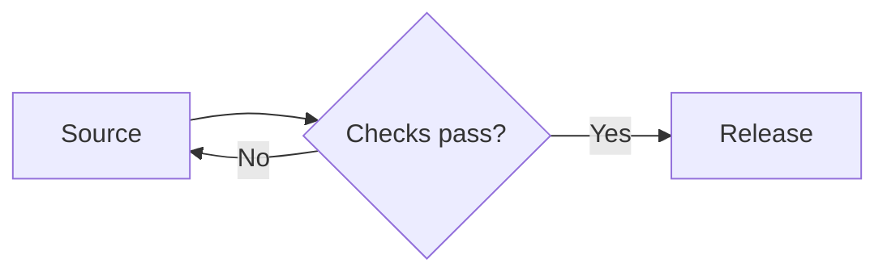

# Markie

Render Markdown and Mermaid diagrams to SVG, PNG, and PDF with a native Rust CLI.
No browser, Node.js, or Python runtime is required.


From [demo-all-features.md](demo-all-features.md): [SVG](demo-all-features.svg) ·
[PNG](demo-all-features.png) · [PDF](demo-all-features.pdf).

## Install

Download a prebuilt archive from [GitHub Releases](https://github.com/lsj5031/MarkieCli/releases).
Archives include `markie` and `markie-mermaid` for:

| Platform | Architectures |
| --- | --- |
| Linux (GNU) | x86_64, aarch64 |
| macOS | Intel, Apple Silicon |
| Windows (MSVC) | x86_64 |

On Linux and macOS, the installer selects the matching release:

```sh
curl -fsSL https://raw.githubusercontent.com/lsj5031/MarkieCli/master/scripts/install.sh | sh
```

It installs into `~/.local/bin`. To choose a version or directory:

```sh
curl -fsSL https://raw.githubusercontent.com/lsj5031/MarkieCli/master/scripts/install.sh | MARKIE_VERSION=0.6.2 INSTALL_DIR="$HOME/.local/bin" sh
```

To build the current source with Rust and a native linker:

```sh
git clone https://github.com/lsj5031/MarkieCli.git
cd MarkieCli
cargo install --path . --locked
```

`cargo install markie` and `cargo binstall markie` use the version published on
crates.io; check its version if you need the latest GitHub fixes.

## Render a document

```sh
markie document.md                         # document.png, 1200px layout at 2× scale
markie document.md -o document.svg         # vector output
markie document.md -o document.pdf         # text rendered as paths
markie document.md -w 640 -t nord          # narrower layout, dark theme
markie document.md --png-scale 3           # higher-resolution PNG
cat document.md | markie - -o output.svg   # stdin
```

The output extension selects the format. Width controls layout in pixels;
`--png-scale` changes raster resolution without changing wrapping. The default
theme needs a width of at least 128px. PDF text is not searchable or selectable.

### Themes

```sh
markie --list-themes
markie document.md --theme dracula
markie document.md --theme ~/themes/custom.toml
```

The 13 built-in themes are `catppuccin_latte`, `catppuccin_mocha`, `dracula`,
`everforest`, `github_dark`, `github_light`, `gruvbox_dark`, `gruvbox_light`,
`monokai_pro`, `nord`, `solarized_dark`, `solarized_light` (default), and `tokyo_night`.
Custom themes use Alacritty YAML or TOML color files.

Some code colors have low contrast, particularly inline/table code in
`github_light`; use `solarized_light` for a more readable light-theme starting point.

### Standalone Mermaid

```sh
markie-mermaid diagram.mmd -o diagram.svg
markie-mermaid diagram.mmd -o diagram.png --png-scale 2
cat diagram.mmd | markie-mermaid - -o diagram.pdf
```

`markie-mermaid` also accepts `--padding` and `--theme PATH` for an Alacritty theme
file. Its default PNG scale is 1×; `markie` defaults to 2×.

Flowchart node labels wrap at a measured width of 18 times the diagram font size,
preferring word boundaries and preserving Unicode graphemes when a word must
split. Explicit newlines and `<br>`, `<br/>`, or `<br />` start new lines. Node
dimensions include the wrapped text, including extra room inside circles and diamonds.

Flowchart edge labels reserve measured space and stay on their connectors while
avoiding nodes, other labels, and group borders. If a route has no room for its
label, it takes a detour through the label's position. This can enlarge the diagram.

In Markdown documents, diagrams start at a 16px base font and shrink to fit the
available content width only while **every text label remains at least 10px** at
the final document size (7.5pt in PDF). This includes smaller sequence messages,
notes, class members, and relationship labels. If the diagram cannot fit, rendering
fails with its source line, effective text size, and suggested minimum `--width`;
it does not clip or silently shrink further. Shorten labels, split the diagram,
increase document width, or use `markie-mermaid` for an export at its natural size.
Increasing `--png-scale` changes raster resolution, not this document-size limit.

Run either command with `--help` for all options. Generate shell completions with
`markie --completions bash` (also zsh, fish, powershell, and elvish).

## Supported input

- Headings, paragraphs, emphasis, strikethrough, inline and highlighted fenced code.
- Ordered/unordered lists, tasks, blockquotes, GFM alerts, and horizontal rules.
- Tables with styled cell content, footnotes, and definition lists.
- Links as styled text; local or HTTP/S PNG/JPEG/SVG images and supported base64 data URLs.
- Inline HTML colors, highlights, underline, superscript, and subscript. HTML blocks display as code.
- Inline/display LaTeX-style math, including fractions, roots, binomials, and matrices.
- Native Mermaid flowchart, sequence, class, state, and ER diagrams.

For example:

````markdown
# Build notes

> [!TIP]
> Render this file with `markie notes.md`.

| Step | Result |
| --- | --- |
| **Compile** | `cargo build` |
| Check | $\sqrt{x^2 + y^2}$ |


````

Mermaid and math implement subsets of their languages. Unsupported Mermaid
families such as pie and Gantt fail with a diagnostic; not every unsupported
statement inside a recognized family is diagnosed. Rich HTML/CSS layouts and
metadata rendering are outside scope.

Local image paths must stay within the input document's directory, including
after resolving symlinks. HTTP/S image downloads have a 10-second timeout and
10 MiB size limit. Unavailable images retain alt text and diagnostics; images in
tables use alt text.

See the [support and quality guide](docs/engine-quality.md) for precise syntax
boundaries, image handling, and known layout limitations. Inspect dense tables,
large diagrams, and complex math at the intended output width.

## Fonts and native exports

Markie uses installed system fonts and valid font files in `./fonts` relative to
the working directory. Install fonts covering the scripts and emoji you render.
On a minimal Debian/Ubuntu system, a useful starting point is:

```sh
sudo apt-get install fonts-dejavu-core fonts-noto-cjk fonts-noto-color-emoji
```

PNG and PDF resolve fonts during export. SVG retains text, so its appearance can
change with the viewer's installed fonts. Outputs are not guaranteed to look
identical across machines.

The native macOS fixes preserve prose spacing, bold text, CJK code, and mixed
accent/emoji code in PNG/PDF, and exclude unusable and last-resort fonts from
fallback. Verification covered Apple Silicon macOS, x86_64 Windows, and Linux;
the Intel Mac binary has not received the same native visual verification.

## Examples

The same demo in four dark themes; click a preview for its SVG:

<p align="center">
  <a href="demo-dracula.svg"></a>
  <a href="demo-nord.svg"></a>
  <br>
  <a href="demo-catppuccin.svg"></a>
  <a href="demo-solarized-dark.svg"></a>
</p>

Browse all committed demo formats in [the gallery](docs/gallery.html).

## Development

```sh
cargo test --locked
cargo fmt --check
cargo clippy --locked --all-targets -- -D warnings
cargo build --release --locked --bins --lib
bash scripts/smoke-test.sh target/engine-quality
```

The smoke script renders math, all five diagram families, and mixed quality
fixtures to SVG/PNG/PDF. If Poppler is installed it also produces PDF previews.
Review the images for missing glyphs, clipping, and diagram routing; structural
checks alone do not establish visual correctness.

Regenerate demos with `bash scripts/make-demo.sh /tmp/markie-demos`. Follow the
[validation guide](docs/engine-quality.md#repeatable-validation) before replacing
committed assets: font environments affect geometry. CI checks tests, formatting,
Clippy, and smoke/demo synchronization on Rust 1.97.1.

Contributions are welcome. Include a small reproducing document and your OS,
font setup, theme, width, and output format when reporting a rendering problem.
See [CHANGELOG.md](CHANGELOG.md) for release history.

## License

[MIT](LICENSE).
