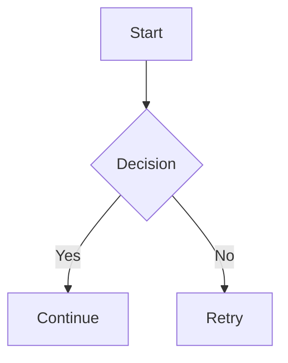

# Markie


Rendered from [`demo-all-features.md`](demo-all-features.md) — also available as [SVG](demo-all-features.svg) and [PDF](demo-all-features.pdf).

A pure Rust Markdown to SVG/PNG/PDF renderer that converts Markdown documents into beautiful, shareable images.

## Features

- **Pure Rust**: Built entirely with Rust for performance and reliability
- **Native CLI**: No Node.js or Python runtime required; text rendering uses installed system fonts or valid fonts in `./fonts`
- **Multiple Output Formats**: Export to SVG, PNG, or PDF
- **High-Resolution PNG Output**: Use `--png-scale` for sharper raster output
- **Native Mermaid Rendering**: A subset of flowchart, sequence, class, state, and ER syntax; see the [support boundary](docs/engine-quality.md)
- **Improved Mermaid Layout**: Sparser node spacing and collision-aware edge label placement
- **Enhanced Math Rendering**: LaTeX-style math including nth roots, binomials, and matrices
- **Customizable Themes**: Supports Alacritty theme files (`.yaml`/`.toml`)
- **13 Built-in Themes**: Dracula, Nord, Tokyo Night, Everforest, Catppuccin, Gruvbox, and more — or use any Alacritty theme file
- **Smart Defaults**: `markie input.md` → `input.png` at 2× retina scale, no flags needed
- **Shell Completions**: `--completions bash/zsh/fish/powershell/elvish`
- **Flexible Input**: Read from file or stdin
- **Adjustable Width**: Control output image width (default: 1200px; minimum 128px with the default spacing)
- **Font Support**: Loads system fonts or valid fonts from `./fonts`, with shared text-measurement caching
- **XML-Safe Output**: Invalid XML control characters are stripped during rendering

## Why Markie?

- **All-in-one renderer** - Markdown text, highlighted code, tables, supported Mermaid diagrams and LaTeX-style math in one document
- **Export choices** - Vector SVG, high-resolution PNG and PDF from the same input
- **PDF export** - Text-as-paths for viewer compatibility; text is not searchable/selectable
- **Direct deployment** - Install the native CLI and provide fonts, without a JavaScript package or runtime setup
- **Native diagram and math engines** - Rendering stays within the Rust application

## Markdown Support

Supported today:

- Headings, paragraphs, emphasis/strong, inline code
- Fenced code blocks with syntax highlighting
- Lists (ordered/unordered) and task lists
- Blockquotes and horizontal rules
- Links (colored text)
- Strikethrough
- Tables
- Images (local files, data URLs, and remote HTTP/S sources)
- Inline and display math (LaTeX-style; supports nth roots, binomials, and matrices)
- Footnotes
- Definition lists
- **Mermaid diagrams** (flowchart, sequence, class, state, ER)
- Inline HTML with basic styling (`<span style="color: ...">`, `<sup>`, `<sub>`, `<u>`, `<mark>`, `<font color="...">`); HTML blocks rendered as code
- **Improved typography and spacing** for better visual consistency

See [demo-all-features.md](demo-all-features.md) for comprehensive examples of all supported features.

Not yet supported:

- Metadata blocks are parsed but ignored
- Rich HTML layouts (tables, grids, CSS classes) — basic inline tags are styled, but HTML blocks render as code

### Mermaid Diagram Support

Markie supports Mermaid diagrams natively in Rust. Use `mermaid` code blocks:

````markdown

````

Supported diagram types:
- **Flowchart**: `flowchart TD/LR` with nodes (rect, rounded, diamond, circle), labels, and arrow variants (circle/cross/open, bidirectional, thick, dotted)
- **Sequence**: `sequenceDiagram` with participants, messages, notes, and control blocks (`alt`, `opt`, `loop`, `par`, `critical` + `else`/`end`)
- **Class**: `classDiagram` with classes, attributes, methods, and relationships
- **State**: `stateDiagram` with states, transitions, composite state children, and notes
- **ER**: `erDiagram` with entities and relationships

Rendering notes:
- Diagram layout is intentionally sparse for readability.
- Edge labels are offset and collision-checked against nodes and nearby labels; complex routing still needs visual review.
- Flat flowchart subgraphs are supported; nested subgraphs are rejected explicitly.
- Unknown diagram families fail the document render with the Mermaid fence line. Not every unsupported statement inside a recognized family is diagnosed.
- See [engine support and quality evidence](docs/engine-quality.md) for syntax boundaries, font requirements, observed limitations, and review instructions.

### Enhanced Math Support

Math is rendered natively from LaTeX-style input, including:
- nth roots (`\sqrt[3]{x}`)
- binomials (`\binom{n}{k}`)
- matrices (`\begin{bmatrix} ... \end{bmatrix}`)

Example:

```markdown
Inline: $\sqrt[3]{x^3 + y^3}$ and $\binom{n}{k}$

$$
\begin{bmatrix}
a & b \\
c & d
\end{bmatrix}
$$
```

## Screenshots

The demo document [`demo-all-features.md`](demo-all-features.md) is committed in every output format — [SVG](demo-all-features.svg), [PNG](demo-all-features.png) (2× retina), and [PDF](demo-all-features.pdf) — rendered with the default `solarized_light` theme.

The same document under the built-in dark themes (click a preview for the vector SVG):

<p align="center">
  <a href="demo-dracula.svg"></a>
  <a href="demo-nord.svg"></a>
  <br>
  <a href="demo-catppuccin.svg"></a>
  <a href="demo-solarized-dark.svg"></a>
</p>

All assets are generated from [`demo-all-features.md`](demo-all-features.md) by [`scripts/make-demo.sh`](scripts/make-demo.sh) — see [Regenerating demo assets](#regenerating-demo-assets). For an interactive, filterable view of every asset, open [`docs/gallery.html`](docs/gallery.html).

## Installation

### From crates.io

```bash
cargo install markie
```

### Fast install with cargo-binstall

```bash
cargo binstall markie
```

### From source

```bash
cargo install --path .
```

### Prebuilt binaries

Download from [GitHub Releases](https://github.com/lsj5031/markiecli/releases) for Linux (x86_64, aarch64), macOS (x86_64, Apple Silicon), and Windows.

### One-line installer (Linux/macOS)

```bash
curl -fsSL https://raw.githubusercontent.com/lsj5031/MarkieCli/master/scripts/install.sh | sh
```

Optional environment overrides:

```bash
curl -fsSL https://raw.githubusercontent.com/lsj5031/MarkieCli/master/scripts/install.sh | MARKIE_VERSION=0.4.0 INSTALL_DIR="$HOME/.local/bin" sh
```

## Usage

### Quick Examples

```bash
# Render markdown to image (auto-detects format from output extension)
markie readme.md                    # → readme.png (2× scale)
markie readme.md -o doc.svg         # → SVG vector
markie readme.md -o doc.pdf         # → PDF document

# Change theme
markie readme.md -t dracula         # Use Dracula dark theme
markie readme.md -t nord            # Use Nord cool theme

# Adjust output
markie readme.md -w 800             # Narrower width
markie readme.md --png-scale 3      # Higher resolution PNG

# Use custom theme file
markie readme.md -t ~/themes/my-theme.toml

# Read from stdin (great for pipelines)
cat readme.md | markie - -o out.svg

# List all available themes
markie --list-themes
```

### Basic usage

```bash
# Render to PNG (default output format, 2× retina scale)
markie input.md

# Explicit output format
markie input.md -o output.svg
markie input.md -o output.png
markie input.md -o output.pdf
```

### From stdin

```bash
cat README.md | markie - -o output.svg
```

### Custom width

```bash
markie input.md -o output.png --width 1200
```

### Built-in themes

13 built-in themes from [alacritty-theme](https://github.com/alacritty/alacritty-theme) are bundled:

```bash
markie input.md --theme dracula
markie input.md --theme nord
markie input.md --theme tokyo_night
markie --list-themes   # Show all available themes
```

Available: `catppuccin_latte`, `catppuccin_mocha`, `dracula`, `everforest`, `github_dark`, `github_light`, `gruvbox_dark`, `gruvbox_light`, `monokai_pro`, `nord`, `solarized_dark`, `solarized_light` (default), `tokyo_night`

See [Screenshots](#screenshots) for rendered examples of the built-in themes.

You can also pass a path to any Alacritty theme file (YAML or TOML):

```bash
markie input.md --theme ~/my-custom-theme.toml
```

### Smoke test script

A local smoke-test helper runs tests and renders math, all five Mermaid families,
and a small quality corpus to SVG/PNG/PDF. It checks representative content and
export dimensions; inspect the outputs for geometry and missing glyphs.

```bash
./scripts/smoke-test.sh ./smoke-test-output
```

Optional overrides:

```bash
THEME_FILE=tests/fixtures/solarized_light.toml PNG_SCALE=2 ./scripts/smoke-test.sh ./smoke-test-output
```

The quality corpus includes long/CJK labels, multiline flowchart nodes, cycles,
self-loops, wide tables, and mixed documents at 640px and 1200px. CI retains the
full outputs as review artifacts instead of adding binary baselines. See the
[validation guide](docs/engine-quality.md#repeatable-validation) for the font
environment and what a passing check does and does not prove.

### Regenerating demo assets

The committed demo files (`demo-all-features.svg/png/pdf` and the themed SVG+PNG pairs) are generated from [`demo-all-features.md`](demo-all-features.md). Regenerate them whenever that file or the renderer changes:

```bash
./scripts/make-demo.sh          # writes to the repo root
./scripts/make-demo.sh /tmp/out # or write somewhere else
```

Optional overrides:

```bash
BIN=./target/release/markie PNG_SCALE=2 WIDTH=1200 ./scripts/make-demo.sh
```

CI checks committed asset content after every push/PR in a pinned font environment.
SVG comparisons strip most geometry, PNG checks compare dimensions, and PDF checks
inspect a signature. These checks detect drift but do not prove visual correctness:

```bash
bash scripts/check-demos.sh /tmp/out
```

## Theme Format

Themes can be passed as a path to an Alacritty theme file (YAML or TOML).

Example of Alacritty TOML theme:

```toml
[colors.primary]
background = '#fdf6e3'
foreground = '#586e75'

[colors.normal]
black   = '#073642'
red     = '#dc322f'
green   = '#859900'
# ... other colors
```

## Building

```bash
cargo build --release
```

The binary will be available at `target/release/markie`.

## Dependencies

- `cosmic-text`: Text shaping and layout
- `pulldown-cmark`: Markdown parsing
- `resvg` + `tiny-skia`: SVG/PNG rendering
- `svg2pdf`: PDF export
- `syntect`: Syntax highlighting
- `clap`: Command-line argument parsing
- `serde`: Serialization/Deserialization (JSON, YAML, TOML)
- `latex2mathml` + `quick-xml`: Math rendering
- `lru` + `parking_lot`: Global font measurement cache

## Status

This is an early experiment. The renderer works well for common use cases, but there's plenty of room for improvement in layout, styling, and feature completeness. PRs welcome to make it better!

## License

MIT License. See [LICENSE](LICENSE) for details.

## Contributing

Contributions are welcome! Please feel free to submit a Pull Request.
