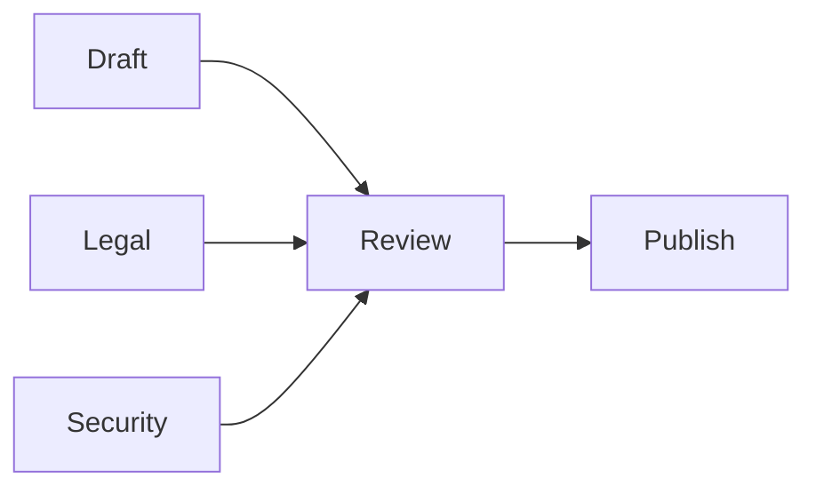
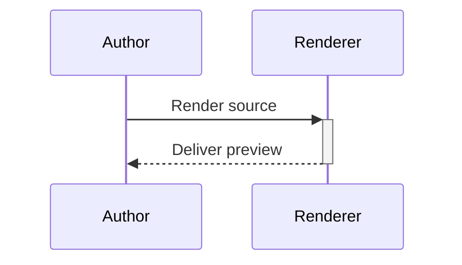
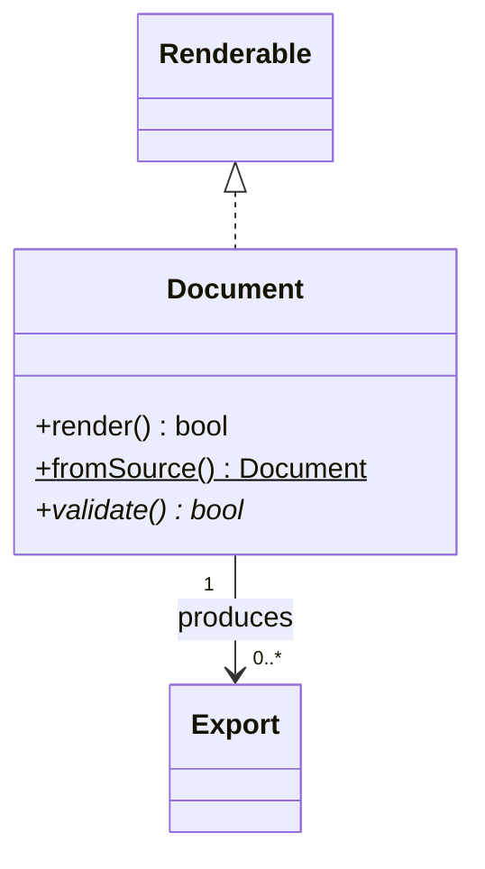

# Everyday syntax compatibility

Before compatibility content: native documents keep formatting and relationships together.

> [!NOTE]
> Review the source and the rendered preview together.

> [!WARNING]
> Confirm the recipient before sharing an export.

| Review item | Status | Next step |
| --- | --- | --- |
| **Document** and *diagrams* | ~~Draft~~ Reviewed | Run `markie --help` |
| [Review packet](https://example.com/review) | <u>Signed</u> Ready | Red notice then plain text |

## Chained and grouped dependencies

## Implicit participants and activation shorthand

## Classes, multiplicities and member classifiers

After compatibility content: every section must remain visible at both document widths.
