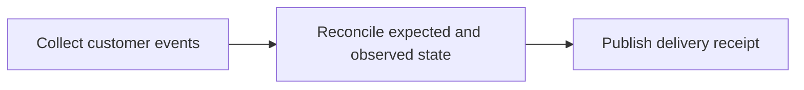

# Document width quality

Before content: a deliberately long paragraph wraps around the available document width. Review both the narrow and wide output for missing words, clipping at the right margin, and spacing between the paragraph and the table. 日本語と中文の表示を確認します。

| Component | Responsibility | Recovery policy | Evidence |
| --- | --- | --- | --- |
| Collector | Collect customer events from the durable intake queue | Retry transient failures with a bounded delay | Intake log |
| Reconciler | Compare expected and observed account state before publishing | Escalate conflicts for human review | Reconciliation report |
| Publisher | Deliver validated results to downstream consumers | Preserve ordering across retry attempts | Delivery receipt |

Inline math $\sqrt[3]{x^3 + y^3}$ sits next to ordinary text.

$$
\frac{a^2 + b^2}{c^2} + \binom{n}{2}
$$

```rust
fn publish(attempt: usize) -> bool {
    attempt < 3 // a short code sample should fit
}
```



After content: this final sentence must be present below the diagram.
