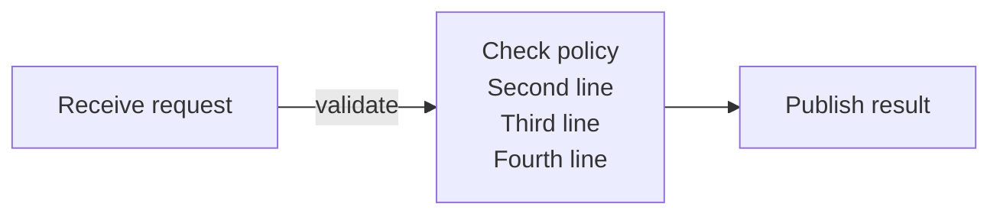
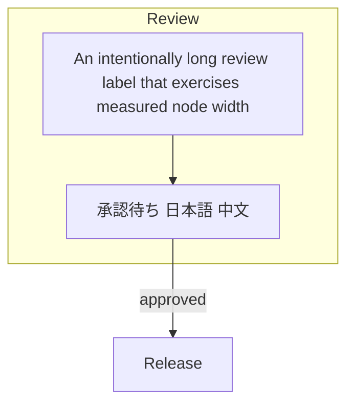
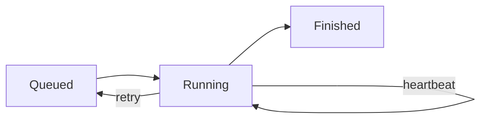

# Flowchart quality

Before the diagram: this paragraph must stay within the document margin.

## Long labels and grouping

## Cycle and self-loop

After the diagram: the final paragraph must remain visible.
